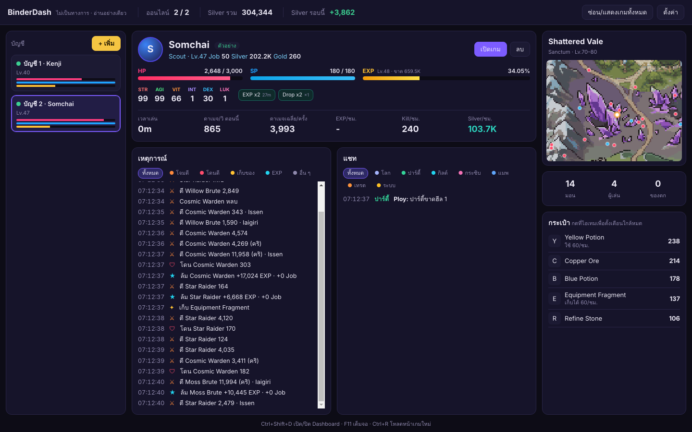

# BinderDash

โปรแกรมแฟนเมดสำหรับเล่น [Binder Town](https://play.bindertowngame.com) หลายบัญชีบน Windows
**ไม่เป็นทางการ ไม่เกี่ยวข้องกับผู้พัฒนาเกม** · อ่านข้อมูลอย่างเดียว ไม่คลิกหรือเล่นแทน (AUTO เป็นของเกมเอง)



## ทำอะไรได้ (v0.9)
- เปิดได้สูงสุด 10 บัญชี แต่ละบัญชีมีหน้าต่างและการล็อกอินแยกกัน (จำการล็อกอินไว้ให้)
- Dashboard รวมทุกบัญชี: สถานะ ออนไลน์/หลุด/ปิดปรับปรุง, HP/SP/EXP, EXP ต่อชั่วโมง, เวลาที่จะอัปเลเวล\*
- Dashboard 3 คอลัมน์: รายชื่อบัญชี (Lv, EXP/ชม., แรม, หลอด HP/SP/EXP) · รายละเอียดตัวละคร (สเตตัส, บัฟ, ดาเมจ/วิ, EXP/ชม., Kill/ชม., Silver/ชม.) + เหตุการณ์/แชทแบบกรองได้ · มินิแมพ, มอน/ผู้เล่นรอบตัว, กระเป๋า (ใช้/เก็บได้ต่อชั่วโมง)\*
- หน้าต่างตั้งค่าแยก (ทั่วไป / แจ้งเตือน / Telegram / ข้อมูล / เกี่ยวกับ): เปิด Dashboard พร้อมโปรแกรม, เปิดทุกบัญชีตอนเริ่ม, เปลี่ยนเซิร์ฟเวอร์เกม, ล้างคุกกี้, ล้างแคช, คืน RAM หน้าเกมเอง, เปิด/ปิดแจ้งเตือนทีละแบบ, เสียง
- แจ้งเตือนไอเทมใกล้หมด: กดที่ไอเทมในกระเป๋าบน Dashboard แล้วใส่จำนวน · ไม่เตือนบัญชีที่กำลังเล่นอยู่ (หน้าต่างเกมที่เปิดหน้าอยู่)
- โหมดตัวอย่าง (ตั้งค่า › ข้อมูล) ใช้ข้อมูลปลอมไว้ดูหน้าตา Dashboard ได้โดยไม่ต้องเข้าเกม
- "ไปที่เกม" เปิดหน้าต่างเกมกลาง Dashboard (ถ้าลากย้ายเองแล้วจะจำตำแหน่งไว้) · ปุ่มมีคำอธิบายเมื่อชี้
- แผนที่: ชื่อแมพ ภูมิภาค ช่วงเลเวล และรูปแมพจาก wiki ของเกม (`src/dashboard/maps.js`) พร้อมจุดตัวเรา มอน ผู้เล่น
- รายได้: Silver/ชม., ขายดรอป/ชม. (ราคาขาย NPC คิดแบบเดียวกับเกม จากประเภทและเลเวลมอน), รายได้รวม/ชม., การ์ดที่ได้และการ์ด/ชม.
- ย่อช่องแชทได้ (ปุ่ม "ย่อ ▸") · ดับเบิลคลิกการ์ดบัญชี = ไปที่เกม · Ctrl+1–9 เลือกบัญชี
- เปิดเกมแบบซ่อน (ตั้งค่า › ทั่วไป) เกมเล่นอยู่เบื้องหลังไม่กินหน้าจอ
- ควบคุมเกมจาก Dashboard (เฉพาะที่ผู้เล่นกดเอง): เปิด/ปิด AUTO, พักจอ, ฟื้นคืนชีพ, ขาย ETC ทั้งหมด, ขายรายชิ้น, ดูราคาตลาด, ส่งแชท/กระซิบ · การขายจากระยะไกลเป็นสิทธิ์ของ Premium ตามกฎเกม
- ซื้อยา HP/MP จากร้าน NPC และย่อยของ (แยกชิ้นอุปกรณ์ ข้ามของที่ล็อก) จาก Dashboard ได้โดยไม่ต้องเปิดหน้าเกม · ซื้อ/ขายผ่าน HUD เป็นสิทธิ์ Premium ตามกฎเกม
- แจ้งเตือนเพิ่ม: ได้การ์ด, ดรอปของมีราคา (ราคาจริงจากตลาดกลางที่ผู้เล่นซื้อขาย ไม่นับ ETC/ยา), ดรอปหายากที่เซิร์ฟประกาศ, ยา/ของใช้จะหมดใน X นาที, กระเป๋าใกล้เต็ม, Premium ใกล้หมด, เลเวลอัป
- ซ่อนเกมแล้วเกมลดการวาดภาพเอง (ภาระวาดภาพลดราว 75% ในการทดสอบ) AUTO ยังล้มมอนได้เท่าเดิม
- เช็กลิสต์รายวันต่อบัญชี: ภารกิจ Pass รายวัน/สัปดาห์ (ทำถึงไหน, ครบแล้วรอกดรับ), จดหมายที่มีของ, Bounty · แจ้งเตือนเมื่อมีของรอรับ · ป้าย 🎁 บนการ์ดบัญชี
- อีเวนต์: แถบบนสุดบอกอีเวนต์ที่กำลังมี (Hot Week, อีเวนต์สุ่ม เช่น Golden Hour / Lucky Find, Mother Lode) พร้อมโบนัสและเวลาที่เหลือ แจ้งเตือนตอนเริ่ม
- สั่งทุกบัญชีพร้อมกัน (ปุ่ม "ทุกบัญชี"): AUTO เปิด/ปิด, พักจอ, ขาย ETC, ซื้อยา · ทำทีละบัญชี ข้ามบัญชีที่เป็นอยู่แล้ว
- รีโมตผ่าน Telegram (ตั้งค่า › Telegram › "รีโมตผ่าน Telegram"): /status, /auto on|off [all|1 2 …], /sleep, /daily, /bosses, /events, /help · รับคำสั่งจากแชทของเจ้าของเท่านั้น
- บอส: กรอบบอสสนามทุกแมพ (เกิดแล้ว / อีกกี่นาที) และ World Boss (Wraithroot Colossus, Pearlheart Titan) พร้อมแจ้งเตือนก่อนเกิดและตอนเกิด
- ตรวจเวอร์ชันเกม: บันทึกชนิดข้อความใหม่ที่เกมเพิ่มเข้ามาลง log (ชื่อและชื่อฟิลด์เท่านั้น) · เช็ก build ของเกมและความครบของข้อมูลทุกครั้งที่เข้าเกม ถ้าเกมอัปเดตแล้วอ่านข้อมูลไม่ครบจะขึ้นเตือนบน Dashboard
- log และรายงานปัญหา: `%APPDATA%\BinderDash\logs\` · ตั้งค่า › ข้อมูล › "สร้างรายงาน" รวมเวอร์ชัน สถานะ และ log ล่าสุดไว้ในไฟล์เดียว (ไม่มีแชท/KEY)
- อัปเดตในแอป: เช็กเวอร์ชันใหม่จาก GitHub Releases ตอนเปิดและทุก 30 นาที ถามก่อน แล้วติดตั้งและเปิดใหม่เอง พร้อมเปิดบัญชีที่เปิดอยู่ให้
- ซ่อนเกม = เกมเล่นต่อเต็มความเร็ว (ไม่ถูกลดความเร็วตอนย่อ/ซ่อน) · ปิดเกม = ตัวละครออกจากเกม
- ไอคอนมุมขวาล่าง: คลิกเพื่อซ่อน/แสดงทุกบัญชี · มีจุดแดงเมื่อมีเรื่องต้องดู
- แจ้งเตือน Windows (+ Telegram ถ้าต้องการ): หลุดจากเซิร์ฟเวอร์, ไม่มีข้อมูลจากเกม (AUTO อาจหยุด), หน้าเกมค้าง, เกมปิดปรับปรุง
- ระหว่างปิดปรับปรุง โปรแกรมลองโหลดใหม่ทุก 2 นาที
- ปุ่มลัด: Ctrl+Shift+D Dashboard · F11 เต็มจอ · Ctrl+R / F5 โหลดหน้าเกมใหม่

\* **อ่านข้อมูลจากเกมจริง** (แมปจากโค้ดเกม build 20261120-084128 และทดสอบกับตัวละครทดสอบในเกมจริงแล้ว):
  - ตัวละคร (ชื่อ อาชีพ Lv Job HP/SP EXP% Silver สเตตัส Premium บัฟ) มอน/ผู้เล่น/ของตกรอบตัว และมินิแมพของเกม: อ่านจาก `window.__game` ของหน้าเกมทุก 1 วินาที
  - ตี/หลบ/โดนตี/ล้มมอน (+EXP/Job/Silver) เก็บของ กระเป๋า แชท กระซิบ คำเชิญปาร์ตี้ ตาย/ฟื้น ping คนในเซิร์ฟ และประกาศของเซิร์ฟเวอร์ (ดรอปของหายาก/ตีบวก): ถอดจากข้อความ Colyseus (msgpack) ที่เกมได้รับ
  - ถ้าเกมอัปเดตแล้วเปลี่ยนรูปแบบข้อมูล ให้แก้ที่ `src/game-adapter.js` (มีเทสต์ใน `src/game-adapter.test.js`)

## การทำงาน
- `src/main.js` จัดการหน้าต่าง, tray, แจ้งเตือน · ดูข้อมูล WebSocket ของเกมผ่าน DevTools protocol และอ่าน `window.__game` ทุก 1 วินาที (อ่านอย่างเดียว ไม่เรียกคำสั่งของเกม ไม่ส่งอะไรไปเซิร์ฟเวอร์)
- `src/game-adapter.js` แปลงข้อความจากเกมเป็นค่าตัวละคร (มีเทสต์ `npm run check`)
- `src/dashboard/` หน้า Dashboard
- ตั้งค่าเก็บที่ `%APPDATA%\BinderDash\config.json` · การล็อกอินแยกตาม partition `persist:acc-<n>`

## รัน / สร้างไฟล์ติดตั้ง
```
cd bindertown-dash
npm install
npm start          # รันโปรแกรม
npm run check      # เช็กไวยากรณ์ + เทสต์
npm run dist       # สร้าง BinderDash-Setup.exe (รันบน Windows)
```

## ข้อควรระวัง
- อ่าน [ข้อกำหนดของเกม](https://bindertowngame.com/terms.html) เรื่องโปรแกรมเสริมและการเล่นหลายบัญชีก่อนใช้/แจก
- ล็อกอิน Google: โปรแกรมแสดงตัวเป็น Chrome ปกติเพื่อให้ Google ยอมให้ล็อกอิน (ยังไม่ได้ทดสอบกับบัญชีจริง)
- โปรแกรมยังไม่เซ็นรับรอง Windows จะขึ้น "Windows protected your PC" ให้กด More info › Run anyway

## ออกเวอร์ชันใหม่ (อัปเดตในแอป)
1. แก้ `version` ใน `package.json`
2. push · GitHub Actions สร้างตัวติดตั้งและ Release `v<version>` ให้ (ถ้ายังไม่มี) โปรแกรมที่ติดตั้งไว้จะเห็นเวอร์ชันใหม่เองภายใน 30 นาที หรือกด "ตรวจหาอัปเดต"

## ทดสอบรีโมต Telegram โดยไม่ใช้ Telegram จริง
`test/telegram-mock.js` เป็นเซิร์ฟเวอร์จำลอง API ของ Telegram (getUpdates / sendMessage) ตั้ง `BINDERDASH_TG_API=http://127.0.0.1:<port>` ก่อนเปิดโปรแกรม แล้วส่งข้อความด้วย `push(chatId, text)`
