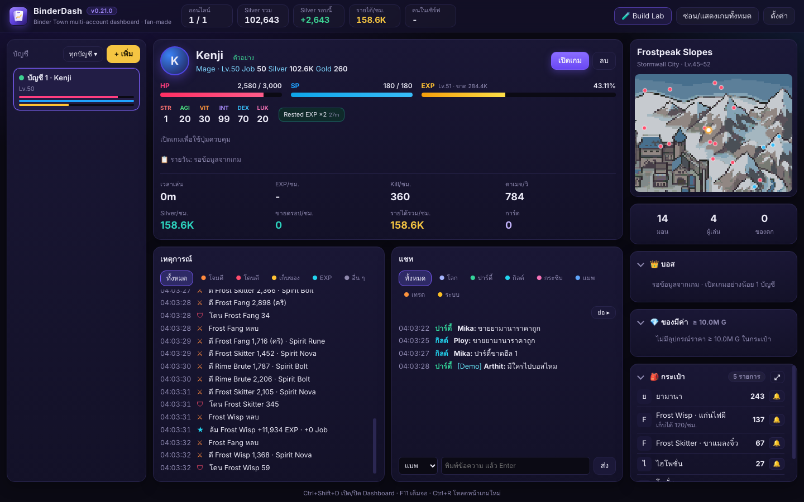
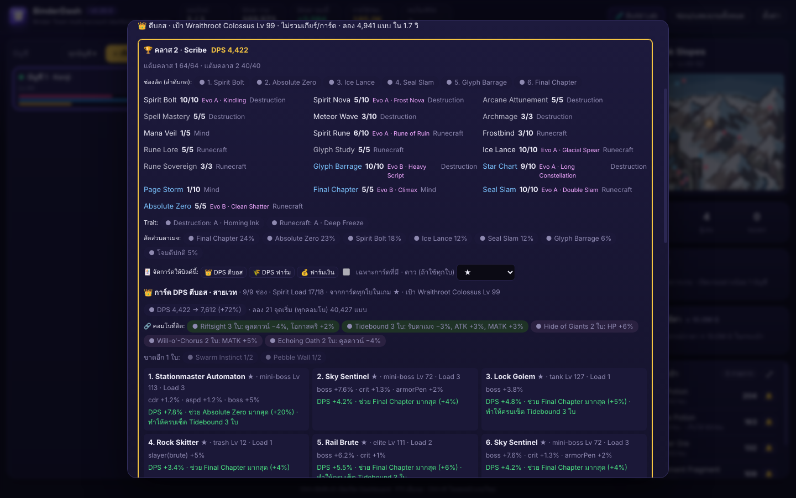
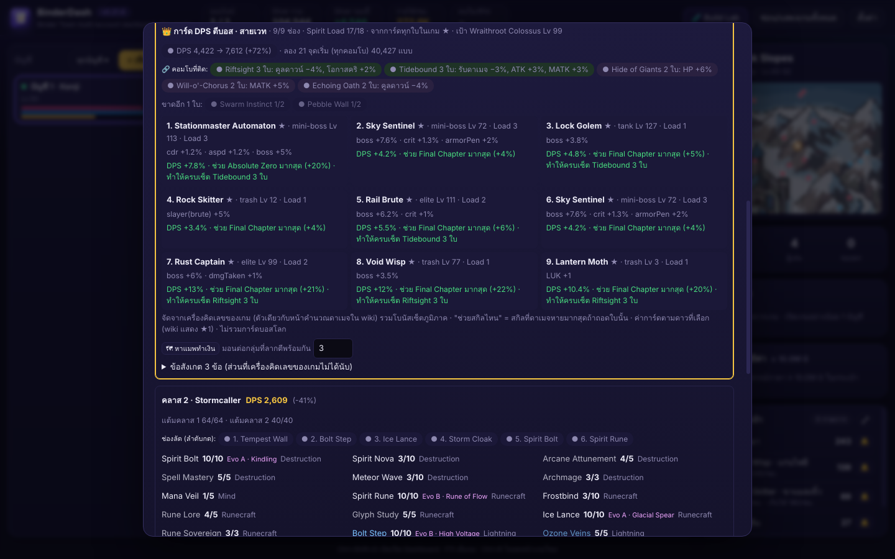

<p align="center"></p>

<h1 align="center">BinderDash</h1>
<p align="center"><b>Multi-account dashboard, game remote and build optimizer for the browser MMORPG <a href="https://play.bindertowngame.com">Binder Town</a></b><br>
Windows + macOS desktop app · Electron · in-app updates · fan-made, not affiliated with the game's developer</p>

<p align="center">🇹🇭 <b><a href="docs/INSTALL-TH.md">คู่มือติดตั้งและใช้งานภาษาไทย</a></b> · <a href="https://github.com/Bdev666/BB/releases/latest">ดาวน์โหลด (Windows / Mac)</a></p>

<p align="center"></p>

## Highlights

- **Every character on one screen.** Up to 10 accounts, each in its own isolated session. Live HP/SP/EXP, damage, kills, Silver and drop value per hour, minimap, bag, chat, bosses and world events.
- **Control the game without opening it.** AUTO, sleep, respawn, buy potions, sell, salvage by grade, and list gear on the player market. Any of these can run for every account in one click, or from your phone through Telegram.
- **🧪 Build Lab.** Finds the strongest skill build (levels, Evolution A/B, line traits, class 2 path, hotbar order) and card build (combos, Spirit Load, stars) for bossing, farming or Gold farming. It runs the **game's own damage calculator**, and its results were checked against real hits in the training ground.
- **Smart alerts.** Valuable drops priced from the live player market, cards, bag weight, bosses, daily rewards, disconnects. Each can go to the Windows notification centre and to Telegram.
- **Self-healing.** Reconnects automatically after drops and page crashes, with backoff. Accounts that were open are reopened after an update.
- **Updates itself.** New versions install from GitHub Releases through an in-app update card, with release notes and progress.

<p align="center">
  
  
</p>

## How it works

```
 Game windows (one Electron partition per account)
   │  WebSocket frames (Colyseus + msgpack) via the DevTools protocol, read-only
   │  window.__game snapshot once a second
   ▼
 game-adapter.js ── decodes server messages into typed events (tests: npm run check)
   ▼
 main.js ── per-account runtime: stats, alerts, reconnect, commands, market, Telegram
   ▼  IPC
 Dashboard (HTML/CSS/JS, no framework)

 Build Lab: a hidden window on the game's site imports the game's own JS module and
 finds its calculator, skill/card/map tables by shape (minified names change every
 game update), then searches builds with it.
```

Engineering notes:
- **Protocol mapping.** I reverse-mapped the game's Colyseus room messages: packed event arrays, inventory deltas, market views, boss timers. The input encoder is byte-identical to the client's, verified against 422 recorded frames.
- **Calculator reuse instead of re-implementation.** The lab calls the same function the game's build-guide pages use, so its numbers follow game patches automatically.
- **Search.** Skill points use a greedy pass with prerequisite chains, then point-move polishing. Cards start from every combo the game has (5 region sets at 3 and 5 cards, 10 kin pairs, 5 colour sets) before fill and swap. Hotbar order is tried in all 720 permutations.
- **Verified against the real game.** A live test character in the training ground found two input mismatches: Novice basics counted twice, and no level-gap bonus on dummies. After fixing both, predicted damage per hit is 25 against a real 24.9, and the attack rate matches the in-game character sheet.

## Features

| Area | What you get |
|---|---|
| Accounts | 10 isolated sessions, hide/show games, hidden games drop to 4 fps (GPU −75%), auto-reconnect, start with Windows |
| Dashboard | HP/SP/EXP, level ETA, damage/s, kills, Silver + drop value per hour, cards, event & chat logs with filters, minimap, foldable side panels |
| Controls | AUTO, sleep, respawn, chat, buy potions (any amount, the shop sells 99 at a time), sell ETC, salvage by grade, list gear on the central market |
| Market | Prices by item kind + grade (lowest listing / last sale), high-value gear panel (≥ 10M), listing tracker for the market's 5-minute delay |
| Build Lab | Skills, Evolution, traits, class 2 (both paths), hotbar order, card builds with combos, best map to farm, competition mode, real DPS test |
| Alerts | Valuable drops, cards, rare drops, potions running out, bag weight 90/95%, bosses, events, daily rewards, disconnects |
| Remote | Telegram bot: `/status`, `/auto on|off [all|n…]`, `/sleep`, `/daily`, `/bosses`, `/events` |
| Support | Logs with rotation, one-file problem report, game-build health check |

## Run / build

```bash
cd bindertown-dash
npm install
npm start          # run
npm run check      # syntax + adapter tests
npm run dist       # Windows installer (CI builds it on GitHub Actions)
```

Releasing: bump `version` in `package.json` and push. GitHub Actions builds the installer and publishes Release `v<version>` with the commit message as release notes. Installed copies pick it up within 30 minutes.

Telegram without Telegram: `test/telegram-mock.js` is a fake Bot API server. Set `BINDERDASH_TG_API=http://127.0.0.1:<port>`.

## Notes

- Fan-made and unofficial. Read the game's [terms](https://bindertowngame.com/terms.html) on add-ons and multiple accounts before using or sharing it.
- The dashboard only does what a player can do by pressing the game's own buttons. AUTO is the game's own feature, and HUD buying and selling stay Premium-only, as the game rules say.
- The installer is not code-signed. Windows SmartScreen shows "More info › Run anyway".
